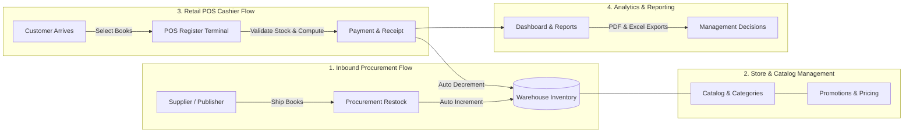

# 📚 Retail Bookstore Management & Point of Sale (POS) System

> [!NOTE]
> **Public Portfolio & Architecture Notice**:
> This public repository serves as a **Frontend, UI/UX, and ASP.NET Core MVC Architecture Showcase** (featuring Controllers, ViewModels, thematic Razor Views, Responsive Styling, and an interactive session cart drawer). The core backend layers (*Domain Entities, CQRS MediatR Handlers, EF Core Infrastructure, and Regression Tests*) are managed separately in a private repository to protect proprietary business logic.

> **Business Overview**: A modern retail bookstore management and point-of-sale information system designed to automate comprehensive bookstore operations — from procurement and inventory management to rapid Point of Sale (POS) checkout and sales analytical reporting.

For software architecture, database schema, test suites, and developer guidelines, please refer to:
👉 **[Developer Technical Documentation (TECHNICAL_DOCUMENTATION.md)](./TECHNICAL_DOCUMENTATION.md)**

---

## 🎯 Background & Business Value

In conventional bookstore operations, common operational challenges include:
1. **Physical Stock vs. Register Mismatches**: Stock discrepancies arising from manual records or systems that fail to update inventory in real-time during cashier transactions.
2. **Slow Cashier Queues**: Time-consuming calculations for basket totals, tiered promotional discounts, and exact change, diminishing customer experience.
3. **Delayed Book Restocking**: Lack of early visibility into best-sellers and titles approaching minimum stock thresholds.
4. **Fragmented Supplier & Customer Relations**: Purchase order histories from publishers/suppliers and customer loyalty data disconnected from daily sales registers.

This system delivers an integrated solution streamlining these workflows into a modern, responsive, and intuitive interface for both store associates and management.

---

## 👥 Business Personas & Roles

The system delegates responsibilities and operational access into two primary roles:

| Role | Core Focus | Business Access Scope |
| :--- | :--- | :--- |
| **Cashier (POS Operator)** | Customer Service & Transaction Speed | - Operate the Point of Sale (POS) register - Search catalog and scan book barcodes/SKUs - Apply automated promotional item discounts - Instant calculation of payment totals and customer change - Print thermal sales receipts - Access and review past sales invoices served |
| **Store Administrator (Manager)** | Operational Management & Strategic Decisions | - Monitor sales performance KPI trends on the Executive Dashboard - Manage book procurement from suppliers with automated inventory replenishment - Curate the book catalog (cost price, retail price, margins, promotional discounts, minimum stock limits, book covers) - Manage master categories, registered customers, and supplier directories - Export financial and sales reconciliation reports in Excel (.xlsx) and PDF formats |

---

## 🔄 Core Business Workflows

### 1. Inbound Procurement Flow
- When bookstore inventory runs low, the store manager issues purchase orders to publishers/suppliers.
- Upon shipment arrival, inbound invoice items are registered in the **Procurement** module.
- The system automatically captures the latest acquisition cost and **accurately increments stock levels** for each received title.

### 2. Retail POS Cashier Flow
- The cashier selects customer items via an interactive fast-search register terminal.
- The system automatically factors in active promotional discounts and computes itemized subtotals.
- The cashier designates whether the purchaser is a registered member or a walk-in guest.
- Real-time inventory verification prevents out-of-stock transactions.
- Upon payment tender, the system issues a unique invoice number, **automatically decrements stock levels**, and triggers a standard 58mm/80mm thermal receipt.

### 3. Catalog Management & Profit Margins
- Each book title links cost price (*purchase cost*) to retail selling price.
- Store managers monitor gross profit margins per title and schedule percentage discounts for marketing campaigns.
- Titles are categorized (Fiction, Non-fiction, Comics/Manga, Academic Textbooks, Technology, etc.) for intuitive shelf placement and catalog filtering.

### 4. Executive Performance & Reporting
- **Executive Dashboard**: Presents revenue trends, daily sales volumes, top-selling titles, and real-time low-stock alerts.
- **Document Exporting**: Financial officers can export sales reconciliation summaries to **Microsoft Excel (.xlsx)** for ledger audit and **Adobe PDF** for executive archival.

---

## 📦 System Modules & Portals

The application features dual integrated presentation portals:

### A. TokoBuku.Web.Cms (Back-Office Admin & POS Cashier Portal)
| Module | Functional Scope | Business Impact |
| :--- | :--- | :--- |
| **Executive Dashboard** | Interactive charts for revenue trends, top-selling books, and real-time inventory health. | Enables store owners to assess business trajectory and customer demand at a glance. |
| **POS Register Terminal** | High-speed checkout register with quantity modifiers, automated change calculator, and thermal printing. | Minimizes checkout queue times and eliminates manual cash calculation errors. |
| **Sales Order History** | Comprehensive audit archive of all completed invoices, timestamps, handling cashiers, and customer records. | Simplifies transaction auditing, dispute resolution, and return inquiries. |
| **Procurement (ERP)** | Inbound stock receiving form with automated supplier cost aggregation. | Eliminates discrepancies between physical warehouse intake and accounting ledgers. |
| **Book & Category Catalog** | Master catalog for ISBN/barcodes, pricing, discount tiers, reorder thresholds, and cover art. | Organized categorization enables cashiers to quickly locate alternative titles when items are out of stock. |
| **Customer Management** | Customer directory with unique member numbers, contact details, and purchase records. | Powers customer retention programs and targeted promotional outreach. |
| **Supplier Directory** | Official registry of publishers and book distributors. | Accelerates supplier reordering and logistics coordination. |

### B. TokoBuku.Web.App (Customer E-Commerce Storefront)

| Module | Functional Scope | Customer Experience Impact |
| :--- | :--- | :--- |
| **Public Catalog & Storefront** | Responsive storefront featuring hero banners, new releases, discount promotions, and category filters. | Empowers customers to browse and discover books digitally 24/7. |
| **Interactive Cart Drawer** | Offcanvas side-drawer cart enabling smooth additions, removals, and quantity adjustments without page reload. | Frictionless shopping journey with instantaneous discount and subtotal updates. |
| **Multi-Option Guest Checkout** | Rapid checkout supporting **Store Pick-Up (Click & Collect)** and **Home Delivery**, with optional account creation. | High flexibility; customers can order seamlessly as guests with mandatory name and email. |
| **Digital Payment Flow** | Automated payment instructions via QRIS and Virtual Account bank transfers. | Safe, cashless digital transactions integrated into the order management pipeline. |
| **Order Tracking** | Real-time invoice lookup tracking fulfillment progress and order timeline by invoice reference. | Complete transparency on order status without needing manual cashier assistance. |

---

## 💡 Operational Advantages

1. **Guaranteed Inventory Integrity**: Zero tolerance for negative stock; every inbound and outbound transaction is mathematically verified.
2. **Optimized Checkout Velocity**: Register checkout is designed for completion within seconds.
3. **Proactive Early Warning Alerts**: Visual notifications alert managers whenever a title drops below its safe stock threshold.
4. **Industry-Standard Thermal Receipts**: Print layouts are formatted for standard 58mm and 80mm thermal receipt printers.

---

## 📖 Related Documentation

- 📘 **[Developer Technical Documentation (TECHNICAL_DOCUMENTATION.md)](./TECHNICAL_DOCUMENTATION.md)**: Comprehensive architectural breakdown of Clean Architecture, SQL Server schema (`MST_*` & `TRX_*`), MediatR CQRS, FluentValidation pipeline, and all 21 automated unit and regression test specifications.
